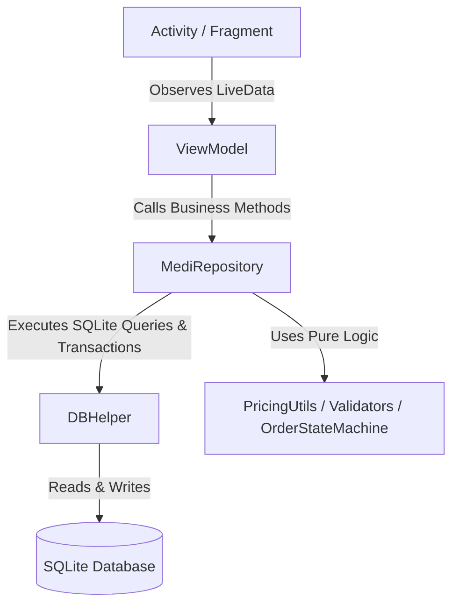
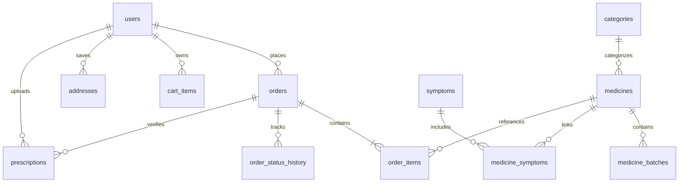

# MediStore 💊

MediStore is a robust, production-ready, offline-first Android pharmacy application built with modern Android architecture components, Material Design 3, and pure SQLite. It provides comprehensive pharmacy retail workflows for customers and administrators, including catalog exploration, symptom-based OTC medicine recommendations, prescription verification, inventory batch tracking (FEFO), order lifecycle state management, and Indian tax invoice generation.

---

## 📸 Screenshots

| Customer Home | Medicine Catalog | Symptom Checker | Cart & Checkout |
|:---:|:---:|:---:|:---:|
| *(Screenshot Placeholder)* | *(Screenshot Placeholder)* | *(Screenshot Placeholder)* | *(Screenshot Placeholder)* |

| Admin Dashboard | Prescription Queue | Inventory & Batches | Tax Invoice PDF |
|:---:|:---:|:---:|:---:|
| *(Screenshot Placeholder)* | *(Screenshot Placeholder)* | *(Screenshot Placeholder)* | *(Screenshot Placeholder)* |

---

## ✨ Features

### 👤 Customer Experience
* **Authentication & Profile**: Customer registration with strict 10-digit Indian mobile validation (`^[6-9]\d{9}$`), email format checks, and secure PBKDF2 password hashing (120,000 rounds).
* **Medicine Search & Discovery**: High-speed full-text search (SQLite FTS4) by brand name, generic formulation, or manufacturer with real-time sync triggers.
* **Symptom Checker v2**: Multi-symptom OTC medicine finder with demographic filtering (child, adult, senior), pregnancy/breastfeeding safety tags, and urgent red-flag advisories.
* **Prescription Enforcement**: Compulsory prescription attachment for all Rx-required medicines (`requires_rx = 1`) before checkout using Camera and Photo Picker. Orders with Rx medicines start as `Awaiting Rx Verification`.
* **Generic Drug Substitutes**: Suggests cheaper bio-equivalent medicines matching the exact same generic formulation and strength, sorted by ascending price with calculated savings.
* **Drug Interaction Warnings**: Cross-checks cart items against drug interaction database (e.g. concurrent NSAIDs, paracetamol duplication) to warn users before checkout.
* **Cart & Smart Checkout**: Stock-aware quantity selectors, Mumbai pincode serviceability validation (400001–400104, Navi Mumbai), and realistic payment selection (COD and simulated UPI).
* **Order Tracking & Reordering**: Full timeline tracking through allowed lifecycle states (`Awaiting Rx Verification` -> `Pending` -> `Confirmed` -> `Preparing` -> `Out for Delivery` -> `Delivered`). One-click reordering and instant PDF tax invoice download.

### 🛡️ Admin & Pharmacist Portal
* **Role-Based Admin Login**: Dedicated administrator access portal.
* **Admin Dashboard**: Live metrics for daily sales, pending orders, low stock (<10 units), out-of-stock items, near-expiry alerts (within 60 days), and Rx verification queue.
* **FEFO Inventory & Batch Tracking**: Earliest-expiring batches are deducted first (`First-Expired, First-Out`), tracking batch numbers directly into order items.
* **Prescription Review Queue**: Pharmacist approval and rejection workflows. Rejection atomically restores stock and provides rejection notes to the customer.
* **CSV Bulk Import**: Transactional import of medicines with strict validation (e.g. price <= MRP, positive stock, required fields) and detailed row rejection reports.
* **Soft Deletion & Stock Adjustments**: Archive discontinued medicines without breaking historical order integrity.

---

## 🛠️ Tech Stack

* **Platform**: Android (minSdk 24, targetSdk 36, Java 17/21)
* **Architecture**: Clean MVVM (Model-View-ViewModel) + Repository Pattern
* **Database**: Local SQLite with SQLiteOpenHelper, Foreign Keys enabled, FTS4 Full-Text Search, and Triggers
* **UI & Theming**: AndroidX, Material Design 3 (MaterialToolbar, MaterialCardView, TextInputLayout, BottomNavigationView, Vector Drawables)
* **Security & Crypto**: PBKDF2 with HmacSHA256 (120,000 iterations, 16-byte random salts), hardened manifest (`android:allowBackup="false"`, single exported launcher activity)
* **Testing**: JUnit 4 (JVM Unit Tests) + AndroidX Test Runner (Instrumented In-Memory Database Tests)
* **Build & Release**: Gradle 9.4, ProGuard / R8 code shrinking and resource optimization

---

## 🏛️ Architecture



---

## 🗄️ Entity-Relationship Diagram (ERD)



---

## 🔑 Default Administrator Credentials

> [!WARNING]
> The application seeds a default demo administrator account on first launch. For production use, immediately change this password or revoke the account.

* **Email / ID**: `admin@medistore.com`
* **Password**: `admin123!`
* **Role**: `admin`

---

## 🚀 How to Build, Run and Test

### Prerequisites
* JDK 17 or JDK 21 installed and configured in `JAVA_HOME`.
* Android SDK (API 36).

### 1. Run JVM Unit Tests
Unit tests run on the JVM without an emulator:
```bash
./gradlew testDebugUnitTest
```

### 2. Run Instrumented Tests
> [!NOTE]
> Instrumented tests (`src/androidTest`) execute in-memory database transactions and require a connected Android device or running emulator:
```bash
./gradlew connectedAndroidTest
```

### 3. Build Debug APK
```bash
./gradlew assembleDebug
```

### 4. Build Release APK (R8 Minified & Shrunk)
```bash
./gradlew assembleRelease
```
The optimized release APK will be located at:
`app/build/outputs/apk/release/app-release-unsigned.apk`

---

## 🧪 CI/CD Pipeline

The project includes an automated GitHub Actions CI workflow (`.github/workflows/ci.yml`) triggered on every push and pull request. It checks out the repository, configures JDK 17, executes `./gradlew testDebugUnitTest`, and builds the debug APK with `./gradlew assembleDebug`.

*Note: Instrumented tests require an active Android emulator and are kept separate from the standard lightweight CI runner.*

---

## ⚠️ Known Limitations

1. **Single-Device SQLite**: The app is designed as an offline-first single-device SQLite database. Administrative and customer actions share the local database instance.
2. **Mock Payment**: Cash on Delivery and simulated UPI flows are provided for realism; no commercial third-party payment gateway SDK is embedded.
3. **Demo Medical Data**: Catalog data and interaction records are curated demonstrations for software evaluation and must not be used as real clinical medical advice.
4. **Push Notifications**: Operates with local in-app notifications and status timelines rather than third-party cloud messaging services.

---

## 🔮 Future Work

* Multi-tenant Cloud Sync (REST API / GraphQL backend sync engine).
* Barcode / DataMatrix scanning via CameraX for automated batch verification.
* Wear OS companion app for scheduled medicine dose reminders.
* Pharmacist digital signature verification for electronic prescription regulatory compliance.
